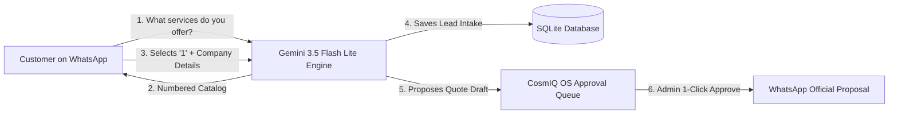

# 🚀 CosmIQ Support & Quotation Engine — Changes & Architecture Summary

> **Quick Overview:** A plain-English breakdown of recent changes, bug fixes, and architecture upgrades made to this repository so anyone on the team can understand what was built and why.

---

## 📌 1. What This System Does

The **CosmIQ Customer Service AI Engine** is an intelligent, multi-channel business automation system connecting **WhatsApp & Telegram** to an internal admin operations dashboard.

---

## 🛠️ 2. The 6 Key Upgrades Made

### 1. 🤖 WhatsApp Bot Tool Calling & Number Selection Fix
* **Issue:** When customers replied with a number (e.g. typing `1` to pick the first service), the Gemini API crashed with `400 Bad Request: missing thought_signature`. The bot then responded with the fallback apology message: *"I couldn’t complete that request right now, so I logged it for human follow-up..."*.
* **Fix:** 
  * Preserved the raw `thought_signature` and `extra_content` required by Gemini 2.5 / 3.5 in the OpenAI-compatible client (`src/llm/openai-compatible.ts`).
  * Updated system prompts so the bot always presents services as a numbered list and maps numbers (`1`, `2`) directly to catalog services.
  * Added exponential backoff retry and automatic model fallback.

### 2. 📋 Auto-Quote & Admin Approval Queue Integration
* **Issue:** After collecting company name, size, and tools, the quote generation failed with `"No active price table for WhatsApp Agent Services"`, meaning quotes were never generated and the Approval Queue remained empty.
* **Fix:**
  * Seeded default pricing catalogs in `src/index.ts` for all core services (`WhatsApp Agent Services`, `Workflow Automation`, `AI Native Internal System`, and `Company Internal Operations Automation`).
  * Automatically invokes `PricingAgent` to choose line items, apply the configured 30% margin, and submit the proposal directly into the **Approval Queue** (`04 QUOTES & APPROVALS`).
  * Backfilled quote generation for existing completed intakes.

### 3. 🎨 CosmIQ OS Brand & Design System (Dual Theme)
* **Upgrade:** Redesigned the admin interface to follow the official **CosmIQ OS Tandem Warm Paper** design specification:
  * **Dual Themes:** Instant toggle between **Warm Paper (Light Mode)** using archival stone tones (`#f4f1ea`) and **Deep Obsidian (Dark Mode)** (`#0a0a0a`).
  * **6 Organized Workspaces:**
    1. `01 Overview` (KPIs, Recent Leads, Approval Queue, Live Chats)
    2. `02 Live Inbox` (Full-page WhatsApp operator terminal)
    3. `03 Leads & Intake` (Structured prospect database)
    4. `04 Quotes & Approvals` (Admin price editor & 1-click approvals)
    5. `05 Catalog & Pricing` (Active services and CSV price table versions)
    6. `06 Telemetry & Logs` (Event audit stream & chat simulator)

### 4. 📐 Layout Rigid Dimensioning & Overlap Elimination
* **Issue:** The chat window stretched downwards indefinitely as messages accumulated, forcing the *Approval Queue* and *Recent Qualified Leads* cards to collide and overlap with the chat composer.
* **Fix:**
  * Rebuilt the Overview hierarchy: Row 1 = KPIs, Row 2 = Leads & Approvals (side-by-side, equal height), Row 3 = Live Conversations.
  * Locked the chat box (`.inbox-card`) to an immutable `600px` height with `overflow: hidden` and internal message scrolling (`min-height: 0` on all flex children). Cards never overlap regardless of message length.
  * Replaced window-level `scrollIntoView()` with container-scoped scrolling to eliminate page jumping on load.

### 5. 📱 Mobile Master-Detail Chat Experience
* **Upgrade:** Full mobile optimization for screens below 640px:
  * Master-detail inbox navigation: users view the conversation list on mobile, tap a chat to expand the full thread, and tap `← INBOX` to return.
  * Sticky navigation bar so controls stay accessible without large desktop headers stealing screen space.

### 6. ⚡ Real-Time Live Sync (Background Auto-Polling)
* **Issue:** When a customer completed a lead on WhatsApp, the admin dashboard kept displaying `0` until the page was manually refreshed.
* **Fix:** Added a background 4-second auto-poll to `dashboard/src/App.tsx`. New WhatsApp leads, completed intakes, and pending approval quotes now appear live on the screen without clicking refresh.

### 7. 🐘 PostgreSQL & Neon Cloud Database Migration (Render Free-Tier Ready)
* **Issue:** Local SQLite (`better-sqlite3`) stored data in an ephemeral container file on Render, risking complete data loss on redeploys or free-tier sleep cycles, and required C++ build tools (`python3`, `make`, `g++`) inside Docker.
* **Upgrade:**
  * Migrated the entire database layer (`src/db/database.ts`, `schema.sql`, migrations `001`–`007`, and all 14 repositories) to **PostgreSQL**.
  * Uses **`pg` (`node-postgres` Pool)** with TLS & advisory-locked migrations when `DATABASE_URL` is set (Neon / Supabase / any Postgres).
  * Falls back seamlessly to embedded **PostgreSQL (`@electric-sql/pglite`)** locally (`./data/pglite`) and in-memory for tests — zero dialect drift between tests and Neon production.
  * Added an atomic, idempotent migration script (`npm run db:migrate-sqlite`) using Node 22's built-in `node:sqlite` to safely transfer existing `support.db` records into Neon while preserving IDs and resetting sequences.
  * Removed `better-sqlite3` and C++ build tools from `Dockerfile` for faster, lighter Render builds.

---

## 🔄 3. Complete End-to-End Walkthrough

1. **Inbound Greeting:** Customer texts `"What services do you offer?"` on WhatsApp.
2. **Catalog Selection:** Bot queries `list_services` and presents options:
   * `1. WhatsApp Agent Services`
   * `2. Workflow Automation`
   * `3. AI Native Internal System`
   * `4. Company Internal Operations Automation`
3. **Number Selection:** Customer sends `1`. Bot immediately identifies the service and begins conversational intake.
4. **Intake Collection:** Bot asks for company name, team size, and existing tooling stack (e.g. *Sisco*, *20 employees*, *Notion*).
5. **Database Persistence:** Every answer triggers `save_intake` in PostgreSQL (`service_intakes` table).
6. **Automatic Quote Generation:** Once intake is complete:
   * `PricingAgent` selects matching catalog items (Setup, Custom Agent, Handoff Console, Monthly Maintenance).
   * Calculates itemized pricing + 30% margin.
   * Generates quote (e.g. `Q-2026-0001` for ₹71,500).
   * Pushes quote into `04 QUOTES & APPROVALS`.
7. **Human in the Loop:** Admin reviews the quote on the dashboard, adjusts margins/quantities if desired, and clicks **Approve**.
8. **Outbound Delivery:** The official formatted quotation is dispatched back to the customer on WhatsApp automatically.

---

## 🧪 4. Test & Verification Summary

* **Unit & Integration Tests:** 125 / 125 tests passing against real PostgreSQL (`npm test`).
* **Golden Conversations Eval:** 10 / 10 passing (`npm run eval`).
* **Frontend Production Build:** Vite bundle builds cleanly in < 750ms (`npm run dashboard:build`).
* **Security Audit:** 0 vulnerabilities (`npm run audit`).
* **Production Deployment:** Deployed via Docker container on Render (`cosmiq-engine`) connected to **Neon PostgreSQL** via `DATABASE_URL`.
